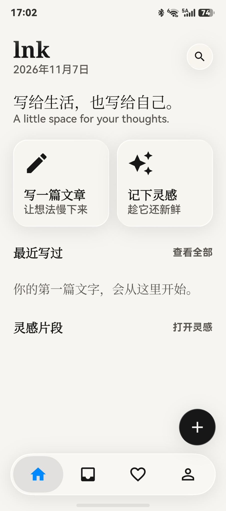
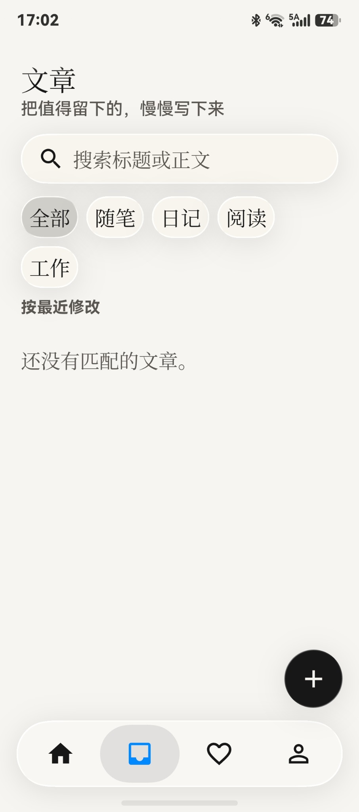
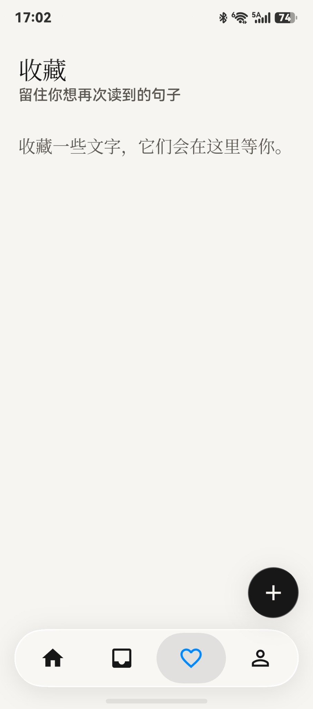
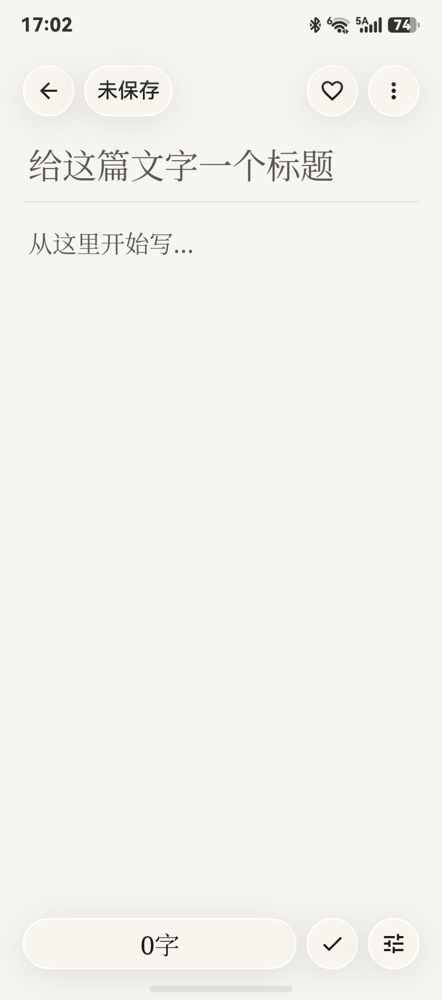
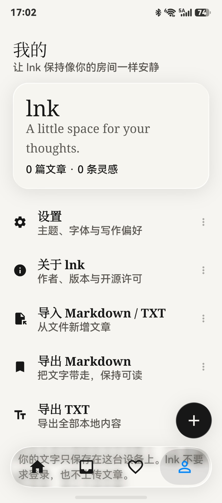

# lnk

**写给生活，也写给自己。**  
*A little space for your thoughts.*

一款用于日常写作、文章整理与灵感记录的轻量应用。

> **项目状态：Beta**
>
> lnk 目前仍处于 Beta
> 阶段，部分功能和交互可能尚不稳定，仍有一些已知或待发现的问题需要修复。欢迎体验，也欢迎反馈问题与建议。

## 关于 lnk

有时想认真写下一段文字，有时只想及时记住一个突然出现的念头。

**lnk**
希望提供一个简单、安静、不被打扰的空间，让你记录日常、整理想法，也收藏那些值得再次读到的句子。

应用以简洁的界面和轻量的写作体验为出发点，不强调复杂的内容管理流程，让写作回到文字本身。

## 界面预览

| 首页                              | 文章列表                              | 收藏                                   |
|-----------------------------------|---------------------------------------|----------------------------------------|
|  |  |  |

| 文章编辑                                | 个人与设置                                 |
|-----------------------------------------|--------------------------------------------|
|  |  |

## 功能介绍

### ✍️ 写作与文章管理

- 创建文章，记录日记、随笔、阅读摘录或工作内容。
- 编辑文章标题与正文，把值得留下的内容慢慢写下来。
- 按文章分类浏览内容，包括随笔、日记、阅读、工作等分类。
- 支持搜索文章标题或正文。
- 按最近修改查看文章。

### ✨ 灵感记录与收藏

- 随时记录一闪而过的想法和灵感。
- 收藏值得再次阅读的文字与句子。
- 在收藏页面集中查看保存的内容。

### 📄 Markdown / TXT 导入与导出

lnk 支持使用常见的纯文本格式管理文章：

| 操作 | 支持格式                         | 说明                         |
|------|----------------------------------|------------------------------|
| 导入 | Markdown（`.md`）、TXT（`.txt`） | 从本地文件导入内容并新增文章 |
| 导出 | Markdown（`.md`）、TXT（`.txt`） | 将文章内容导出为对应格式     |

你可以将文章导出到本地保存，也可以在需要时将 Markdown 或 TXT
文件重新导入。

### 🎨 简洁的界面与个性化设置

- 采用克制、留白充足的界面布局，减少写作时的视觉干扰。
- UI 视觉设计参考 Liquid Glass 风格。
- 提供主题、字体与写作偏好等设置入口。

### 🔒 本地优先

当前版本的设计说明为：无需注册或登录，文字保存在设备本地，文章内容不会上传。请注意，Beta
版本仍可能存在数据相关问题，建议定期使用导出功能备份重要文章。

## 设计参考

lnk 的 UI 视觉设计参考了
[Kyant0/AndroidLiquidGlass](https://github.com/Kyant0/AndroidLiquidGlass)
项目所展示的 Liquid Glass 效果。

感谢原作者分享相关设计与实现。该链接用于说明 UI 设计参考来源；这并不代表
lnk
一定直接依赖或包含该项目的代码。若后续实际采用其代码或依赖，请遵循原项目的许可证及相关声明要求。

## Beta 说明

目前 lnk 仍处于早期测试阶段：

- 部分功能可能尚未完善，界面和交互也可能继续调整。
- 可能存在尚未发现或尚未修复的 Bug。
- 不建议将当前 Beta 版本作为重要资料的唯一存储位置。
- 建议定期通过 Markdown / TXT 导出功能备份重要内容。

如果遇到问题，欢迎提交反馈。为了帮助定位问题，反馈时可以尽量附上：

- 设备型号与系统版本；
- lnk 的版本号；
- 问题出现时的操作步骤；
- 相关截图，以及问题是否可以稳定复现。

## 写在最后

希望 lnk 能成为一个让你愿意随时打开的地方。

写下一篇文章，记住一个灵感，收藏一句喜欢的话。

**写给生活，也写给自己。**
